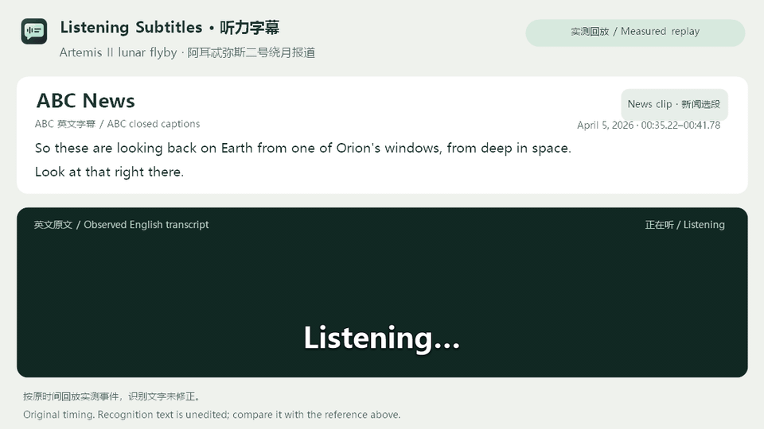

# Listening Subtitles · 听力字幕

A Windows desktop app dedicated to **speech recognition, live subtitle transcription and caption export**. Transcribe speech playing through your computer, display centered, outlined original and translated text in a transparent desktop-lyrics overlay, and export SRT, WebVTT (CC) or TXT. Use it for videos without captions, recorded lessons, podcasts and listening practice. The interface supports Simplified Chinese and English; spoken language and translation target are configured separately. The default is English speech → Simplified Chinese translation.

**专门用于语音识别、实时字幕转录和字幕文件导出的 Windows 桌面工具。** 默认以透明桌面歌词显示居中描边的原文和译文，支持中英文界面及 SRT / VTT / TXT 导出。

[中文说明 / Bilingual introduction](README.md) · [Download for Windows](https://github.com/Desolate-Jix/listening-subtitles/releases/latest) · [Source](https://github.com/Desolate-Jix/listening-subtitles) · [MIT License](LICENSE)

## Live transcription of an ABC News clip

The first English word arrived **1.12 seconds** into this 6.56-second excerpt from an ABC News report on the Artemis II lunar flyby. Open the broadcast at **00:35** to hear the speaker. The animation replays the captions at the times the app received them. [Listen to the ABC News source (00:35.22–00:41.78)](https://abcnews.com/video/131741110/)



Across two sentences, the app picked up **all 21 words in the ABC captions, in order**, including *Orion’s windows*. It repeated *space* at the segment boundary, as the replay shows. The last segment became final **1.13 seconds after the excerpt ended**. [Inspect the measured times and final transcript](https://github.com/Desolate-Jix/listening-subtitles/blob/main/docs/demo/abc-news-timing.json)

This run used v1.6.0’s default `gpt-live-transcribe` model. The original audio was sent at playback speed over an established connection, with the timer starting at the beginning of the excerpt. These timings cover English transcription for this sample. With automatic translation enabled, a translation follows each finalized segment.

## Start

1. Download and fully extract the Windows x64 ZIP. Run `ListeningSubtitles.exe`.
2. Hover over the lyrics, open **… → Settings → Connection**, enter your own OpenAI API key and save. Credentials are encrypted locally with Windows DPAPI.
3. Choose Simplified Chinese or English for the interface; Simplified Chinese is the default. This does not change the spoken source language or translation target.
4. Configure the source language and translation target. The default is English (`en`) → Simplified Chinese (`zh-Hans`).
5. Play your video/audio, then press Start. Stop ends capture and pending network work. Opening the app alone never starts capture or contacts the API.
6. Open History from the “…” menu or tray to review, fill translations for the current target, or export captions. Select earlier recordings from the list. Starting a new recording saves the current one first.

A line above the current subtitle shows the previous sentence’s translation when it is ready. If translation falls several sentences behind, the most recent earlier sentence with a translation stays in view. When translations are hidden or none are available yet, the line shows the previous original.

Hover near the lyrics to reveal the toolbar. Use **A− / A+** to resize the text, drag the words to reposition them and select the **padlock** to lock them in place. Hover over locked lyrics to reveal a single **Unlock** button. Only the button receives clicks. Clicks on the text or surrounding space pass through to the player. Move away to hide the button. You can also unlock from the Windows tray menu. The app remembers the locked position after a restart.

You can start and stop transcription from the toolbar or the tray menu. The “…” and tray menus both open Settings, History and the full control window. History shows the full text of long segments. Each caption is timed as a segment.

The app captures **system output audio only**, not the microphone. Other apps playing through the selected output device are included. It follows the Windows default headphones/speakers unless you select a fixed playback device. Play existing audio/video files in a media player to transcribe them; there is no batch file-import interface. Windows 10/11 x64 is required.

Default transcription: `gpt-live-transcribe`, language `en`. Enter a single source-language code such as `ja`, comma-separated codes such as `zh,en`, or leave blank for automatic recognition. Automatic translation is on by default and uses `gpt-6-luna`; change the model in Settings. Hiding translations changes the floating window only; turn off automatic translation to stop translation requests. Model access depends on your API account. Transcription, automatic translation and explicit history translation incur OpenAI API charges; no shared key or API credits are included, and a ChatGPT subscription is not required.

Translation targets are Simplified Chinese `zh-Hans`, Traditional Chinese `zh-Hant`, English `en`, Japanese `ja`, Korean `ko`, French `fr`, German `de`, Spanish `es`, Portuguese `pt`, Russian `ru`, Arabic `ar`, Hindi `hi` and Italian `it`. For example, source `ja` with target `en` means Japanese speech → English subtitles; a blank source with target `zh-Hant` means automatic speech recognition → Traditional Chinese subtitles. Recognition and translation quality depend on the input and models; supported languages may differ in quality.

## Captions and timing

- **The first caption starts at 00:00:00.000 by default.** All later gaps and durations are preserved. History, TXT, SRT and VTT use the same relative timeline.
- Disable the option to start the first caption at zero to use capture start as the origin, retaining leading silence.
- The overall offset applies a signed value in seconds to the history view and exports. Positive delays the captions; negative advances them. Time before zero is clipped.
- SRT, VTT and TXT share the same language-mode selector: bilingual (original + selected target), original-only or target-only. Bilingual does not mean a fixed English/Chinese pair.
- Exports use only translations matching the current target. Target-only output skips segments without matching translations; the export flow reports missing translations.
- SRT/VTT include completed segments only. TXT in original-only or bilingual mode can also retain an unfinished trailing segment, marked as incomplete.
- Dates in the recording selector and filenames identify recordings, not cue positions.
- Timing is approximate, based on captured audio segments, not translation arrival. It is not word alignment and does not track media seeking, pauses or playback-speed changes.
- Files are readable UTF-8. Name an SRT to match the video and load it in a supporting player. An exported VTT file can be loaded as a caption track by a supporting website/player; it does not automatically add CC support to arbitrary websites.

## History and data

Originals and translations are encrypted under `%LOCALAPPDATA%\ListeningSubtitles\history`, saved approximately every second when changed and during normal stop/exit. The latest recording reopens on startup; older recordings are selectable in History. Late translations update their own rows. Completed captions are retained beyond 500 entries. A recording has an approximately 64 MB storage limit. A power failure or forced exit may lose the latest unsaved changes.

Changing the target does not automatically translate existing history. Old translations retain their actual language label. Filling translations uses the current target: matching translations remain, while completed segments with missing or different-language translations can be translated. Only successful results replace old translations; failures preserve them. Historic translation uses the source language recorded with the speech; legacy records without that information use automatic recognition. Other-language translations remain in history, but are excluded from current-target exports.

Clearing the current window does not remove saved recordings. To manage unwanted local recordings, exit the app before changing files in the `history` directory. Existing encrypted history from earlier versions remains readable; legacy Chinese translations are treated as Simplified Chinese. Export any memory-only history in an older running version before closing it.

API credentials are independently encrypted in the same application data directory. No other app is required. Only the original Windows account can decrypt these files; export text/captions for portability. Exported files are ordinary readable UTF-8 files.

Audio is sent to OpenAI only while capture is started. Translation sends the relevant transcript text using stateless Responses API calls with `store: false`. The app saves no raw audio and has no telemetry or automatic startup. System capture includes other sounds routed to the selected playback device.

Continuous speech is submitted in segments of about five seconds; a pause of about 800 ms can also end a segment. Translation adds another request, so zero latency is not guaranteed. Stopping cancels pending translations and uncommitted speech. Fill completed segments afterward when needed; this incurs API usage. The translation queue is bounded, so backlog or failure leaves originals available for later translation. No automatic retries/reconnects are performed.

Recognition, translation and timing may be wrong; these are not the video's official captions. Exclusive fullscreen, protected content or a player using another output device may affect capture or the floating window. Export and start a new recording before reaching the approximately 64 MB per-recording limit.

## Build and test

Requires Windows, .NET 8 SDK and NAudio 2.4.0 (NuGet). Published ZIPs include the .NET/WindowsDesktop runtime.

```powershell
dotnet run --project ListeningSubtitles.csproj -c Release
dotnet run --project tests/ListeningSubtitles.Tests.csproj -c Release
dotnet run --project tests/Speech/SpeechTests.csproj -c Release
powershell -ExecutionPolicy Bypass -File scripts/build.ps1
```

The output is `artifacts/win-x64`. Keep all published files together. Tests use synthetic audio and fake HTTP/WebSocket transports, require no API key and do not call paid APIs. `--preview <temporary-directory>` renders synthetic captions without reading a real key, capturing audio or accessing an API. Offline checks do not establish real-video recognition accuracy, translation quality across languages or network latency, and do not mean every supported language has been tested live.

MIT licensed; NAudio and derived `SafeWasapiCapture` retain upstream copyright notices. See [licenses/NAudio-2.4.0.txt](licenses/NAudio-2.4.0.txt).

- [OpenAI Realtime transcription](https://developers.openai.com/api/docs/guides/realtime-transcription)
- [Responses API](https://developers.openai.com/api/reference/resources/responses/methods/create)
- [W3C WebVTT](https://www.w3.org/TR/webvtt1/)
- [SRT format overview](https://www.loc.gov/preservation/digital/formats/fdd/fdd000569.shtml)
